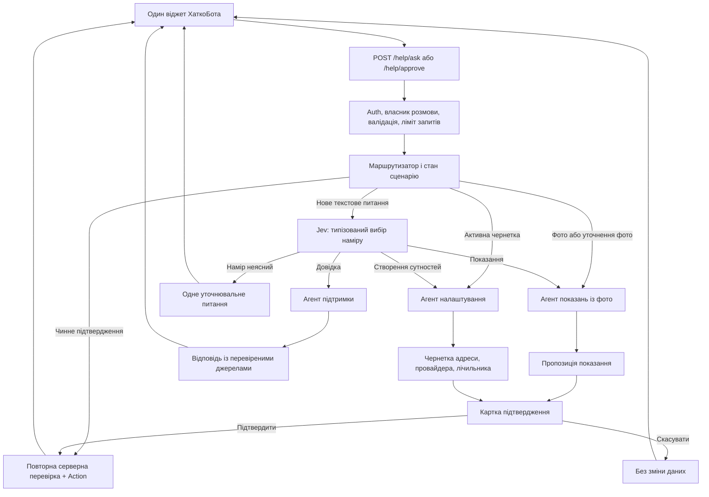

# ХаткоБот: архітектура маршрутизації трьох агентів

**Статус:** серверна й клієнтська реалізація виконана; калібрування Jev та переіндексація RAG очікують зовнішніх кроків. **Дата:** 2026-10-20.

## Мета й межі

Користувач спілкується з одним ХаткоБотом в одному віджеті. Застосунок автоматично спрямовує звернення до одного з трьох спеціалістів: внесення показань із фото, налаштування адрес/провайдерів/лічильників або довідкова підтримка. Користувач не обирає агента вручну. Архітектура зберігає поточні маршрути `POST /help/ask` і `POST /help/approve` та чинне правило: жодної зміни даних до явного підтвердження.

Нижче збережено цільову схему та обґрунтування рішень. Чинний серверний потік: `HelpChatWidget` → `/help/ask` → `RouteHelpTurn` → один із `MeterReadingAgent`, `PropertySetupAgent`, `ProductSupportAgent`. `HelpAssistant` лишився адаптером для старих SDK-розмов. Стан реалізації та запуск описані в [поточному описі](support-agent.md).

## Головне рішення

**Маршрутизатор є кодом застосунку, а класифікатор наміру — окремим викликом TypeSafe Jev.** Маршрутизатор перевіряє авторизацію і стан сценарію, застосовує безумовні правила для фото та підтверджень, а для решти повідомлень просить модель повернути структурований намір із закритого переліку. Лише сервер зіставляє цей намір із дозволеним класом агента. Модель не задає PHP-клас, назву інструмента, `user_id` чи довільний ID об'єкта.

Laravel AI SDK дозволяє повертати агента з `tools()` іншого агента: батьківська модель тоді сама делегує текстову задачу. У встановленому SDK 1.2 такий `AgentTool` передає дочірньому агенту лише `task` і повертає батьку текст відповіді; історія батька й фото не переходять автоматично. Тому **агенти, які приймають фото або створюють записи, викликаються маршрутизатором напряму**, а не як вкладений `AgentTool`. Для безпечних довідкових підзадач вкладена делегація можлива пізніше. Підстава: [Laravel AI SDK, Sub-Agents](https://laravel.com/framework/docs/13.x/ai-sdk#sub-agents), [Conversation Context](https://laravel.com/framework/docs/13.x/ai-sdk#conversation-context), [`AgentTool` у встановленій версії](../vendor/laravel/ai/src/Tools/AgentTool.php). Ці розділи перевірено через Laravel Boost MCP `search-docs`.

## Алгоритм маршрутизації

Порядок пріоритетів на кожному ході:

1. `POST /help/approve` з чинним `approval_id` продовжує саме той сценарій, який створив пропозицію. Повторної класифікації немає. Сервер перевіряє власника, строк дії, статус і незмінність пропозиції.
2. Нове фото або незавершене уточнення до фото йде до агента показань. Фото передається йому як вкладення, а не як текстовий опис від маршрутизатора.
3. Активна чернетка створення адреси/провайдера/лічильника продовжується агентом налаштування. Якщо користувач явно почав іншу тему, бот пропонує завершити, призупинити або скасувати чернетку.
4. Для іншого тексту окремий `IntentClassifier` повертає структурований результат: `meter_reading | property_setup | product_support | clarify` і, за потреби, намір уточнення. Сервер перевіряє значення проти enum. Самооцінка впевненості моделі не замінює перевірку потрібних даних.
5. Якщо запит стосується кількох сценаріїв, маршрутизатор виконує їх послідовно, з окремими чернетками та підтвердженнями; якщо порядок незрозумілий — уточнює. Агент може попросити передачу іншому спеціалісту, але сам перехід здійснює сервер після перевірки стану.

Якщо класифікатор недоступний або повернув невідомий намір, фото й чинне підтвердження продовжують свої серверні сценарії. Для звичайного тексту застосунок повертає наявну локальну довідкову відповідь або просить уточнити запит. Новий сценарій створення об'єктів і будь-який запис за такого збою не запускаються.

Маршрутизатор передає агенту лише потрібні дані: повідомлення, довірений стан сценарію, дозволені ID та короткий перевірений контекст. Інструкції з повідомлення, фото й пошукових документів не можуть змінити маршрут або права агента.

## Роль TypeSafe Jev

Jev — **модель прийняття типізованих рішень**, а не агент, який пише відповідь користувачу чи викликає доменні tools. Її єдине обов'язкове місце в першій версії — `IntentClassifier` у кроці 4 алгоритму вище. Поточний Laravel AI SDK 1.2 має `Classification` з питанням `Choice`, відповіддю `choice`/`probabilities`/`confidence` та OpenRouter gateway, який викликає Decisions API. Для інтеграції достатньо SDK `Classification::of($state)->question('intent', new Choice(...))->classify(provider: 'openrouter', model: 'typesafe/jev-1.14')`; окремий HTTP-клієнт не потрібен. Обидва аргументи `classify` треба задати явно: у поточному `config/ai.php` немає `default_for_classification` чи моделі класифікації. API Classification у SDK позначено експериментальним, тому його контракт треба зафіксувати тестами. Джерела: [Laravel AI SDK Classification](https://laravel.com/framework/docs/13.x/ai-sdk#classification), [OpenRouter Jev 1.14](https://openrouter.ai/typesafe/jev-1.14), [OpenRouter Decisions API](https://openrouter.ai/blog/insights/what-is-jev/).

| Рішення Jev | Значення для маршрутизатора |
|---|---|
| `meter_reading` | Текст про показання або уточнення лічильника → агент показань. Саме фото й pending approval уже спрямовані сюди без Jev. |
| `property_setup` | Створення адреси, провайдера чи лічильника → агент налаштування. |
| `product_support` | Питання «як користуватися?» → агент підтримки. |
| `clarify` | Намір не визначений або користувач просить кілька несумісних дій → коротке уточнення без запису. |

Запит до Jev містить поточний текст і лише мінімальний стан, необхідний для тлумачення фрази на кшталт «а тепер додай його»: активний тип сценарію та коротке знеособлене резюме. Не передавати фото, повну історію, адреси, серійні номери, внутрішні ID чи pending approval. За потреби в одному виклику можна додати друге типізоване питання: чи користувач явно змінює тему активної чернетки. Сервер усе одно вирішує, чи дозволяти перехід.

Сервер приймає тільки один із чотирьох дозволених варіантів, порівнює ймовірність першого варіанта з порогом і відривом від другого, а слабкі/суперечливі результати переводить у `clarify`. Відсутній ключ відповіді, невідомий варіант, неповний розподіл ймовірностей або `null` у `confidence` обробляються як невизначений маршрут. Пороги підбирають на розмічених українських запитах ХаткоБота; універсальний поріг не закладається. Відповідь Jev ніколи не є дозволом на запис або заміною Policy, валідації та підтвердження користувача. Якщо Jev недоступний, діє описаний вище консервативний fallback.

**Розподіл моделей:** Jev 1.14 — лише рішення про маршрут; фотоагент — окрема модель, яка читає довільні цифри з фото і підтримує tool calls; агент налаштування — модель для діалогу, структурованих пропозицій і збору полів; агент підтримки — модель для докладної української відповіді за RAG. Конфігурація має окремі `AI_ROUTER_MODEL`, `AI_METER_MODEL`, `AI_SETUP_MODEL` і `AI_SUPPORT_MODEL`. Jev не використовують для генерації відповіді чи читання фото: встановлений SDK відхиляє вкладення для OpenRouter Classification до відправлення запиту.

## Агент 1: показання з фото

**Завдання:** визначити вид послуги й значення на фото, знайти **наявний активний лічильник користувача за правильною адресою**, зібрати відсутні дані та підготувати показання до підтвердження.

| Етап | Рішення агента і сервера |
|---|---|
| Розпізнавання | Модель читає дисплей, вид послуги, видимий серійний номер і тарифну зону. Якщо значення, десятковий роздільник або зона нечіткі — просить чіткіше фото чи уточнення. Один знімок дає одну пропозицію показання. |
| Пошук адреси | Серверний read tool повертає лише активні лічильники адрес поточного користувача: адреса, назва, розташування, тип, серійний номер, зони, останні значення. Спочатку шукаємо однозначний збіг серійного номера і типу; потім зіставляємо назву/розташування та вибір користувача. Фото саме по собі, GPS або EXIF не доводять адресу. |
| Неоднозначність | Якщо є кілька кандидатів, показати користувачу адреси й лічильники для вибору. Якщо збігів немає, запропонувати створити лічильник через агента налаштування; не створювати його мовчки. |
| Дата і тариф | Використати чинне правило EXIF-дати; коли EXIF немає або дата некоректна — попросити дату. Для кількох зон вимагати вибір однієї з чинних зон цього лічильника. |
| Пропозиція | Сервер повторно перевіряє фото, власника адреси, активність і тип лічильника, дату, значення відносно останнього показання та сумісність тарифу. До підтвердження запису в `meter_readings` немає. |
| Підтвердження | Картка показує адресу, лічильник, тип послуги, значення, дату й її джерело, зону та попереднє показання. Користувач може підтвердити, скасувати або виправити дозволені поля; після виправлення сервер перевіряє все знову. |

**Інструменти:** read-only список власних активних лічильників і деталей кандидата; наявний approvable `RecordMeterReading` для запису. Підтримувані поточним фотофлоу типи: холодна/гаряча вода, електроенергія, газ. Наявні [`DescribeUserMeters`](../Modules/Ai/Actions/DescribeUserMeters.php), [`ValidateMeterReadingProposal`](../Modules/Ai/Actions/ValidateMeterReadingProposal.php), [`RecordMeterReading`](../Modules/Ai/Tools/RecordMeterReading.php) і [`ResolveHelpApproval`](../Modules/Ai/Actions/ResolveHelpApproval.php) — основа, а не логіка для дублювання.

Обробка фото має зберегти чинні серверні обмеження формату/розміру/роздільності, декодування першого кадру, приватний диск, очищення метаданих після зчитування дати, 24-годинний строк зберігання й видалення після використання. Фото передається зовнішній моделі лише в межах цього сценарію; політика зберігання даних провайдера має бути відома користувачу. Див. [`StoreAssistantMeterPhoto`](../Modules/Ai/Actions/StoreAssistantMeterPhoto.php) та [`AssistantMeterPhoto`](../Modules/Ai/Models/AssistantMeterPhoto.php).

Фото й підтвердження мають строк дії. Одне фото або одне підтвердження не можуть створити два показання, зокрема за одночасних запитів у двох вкладках. Поточна система допускає різні показання на ту саму дату; правило для такого дубля треба визначити перед реалізацією.

## Агент 2: адреси, провайдери та лічильники

**Завдання:** вести користувача через створення однієї або кількох пов'язаних сутностей, збирати поля в чернетку, показувати підсумок і запускати серверні Actions після підтвердження.

**Дозволений порядок:** вибрати наявну адресу або створити нову → за потреби створити провайдера для цієї адреси → створити лічильник за адресою та, за бажанням, прив'язати до провайдера. Можна створити лише адресу, лише провайдера для наявної адреси або лише лічильник. Тарифи є необов'язковою частиною створення провайдера в поточному UI; у першому етапі агент збирає їх тільки на явний запит користувача.

| Сутність | Обов'язкові поля | Серверні правила |
|---|---|---|
| Адреса | Область, тип адреси, місто, вулиця, номер будинку | Квартира, індекс, нотатки та ознака основної адреси необов'язкові. Створення одразу прив'язує адресу до користувача. |
| Провайдер | Адреса користувача, тип послуги, назва | Контакти й тарифи необов'язкові. Тарифи, якщо задані, мають відповідати провайдеру і типу послуги. |
| Лічильник | Адреса користувача, тип послуги, серійний номер, назва, початкове показання | Провайдер необов'язковий; якщо заданий, мусить належати **цій самій адресі** й мати **той самий тип послуги**. Перед створенням показати схожі наявні лічильники. |

**Інструменти:** окремі read tools для довідників, адрес користувача, провайдерів вибраної адреси та лічильників; окремі інструменти формування пропозицій для адреси, провайдера й лічильника; один серверний шлях підтвердження чернетки. Інструменти пропозицій нічого не записують. Перед записом сервер перевіряє Form Request/DTO-подібні правила, Policy/володіння, існування довідникових ID, дублікати й зв'язки. `user_id` береться з автентифікації, а не з аргументів моделі.

Агенту не надається універсальний CRUD tool. Його структурована пропозиція — недовірений вхід: PHP розв'язує кожен ID лише серед дозволених користувачу записів і викликає вузькі доменні Actions після підтвердження.

Для запиту «створи адресу, провайдера й лічильник» цільовий UX — **одна зведена картка** з усіма полями й одним явним підтвердженням. Запис виконується у правильному порядку в одній транзакції БД, або не виконується зовсім. Якщо згодом додадуть завантаження фото лічильника до цього пакета, життєвий цикл файла треба узгодити з транзакцією окремо. Скасування не створює жодної сутності. Повторне підтвердження не дублює об'єкти.

Перевірка схожих записів до показу картки лише допомагає користувачу. На момент запису той самий Action повторює перевірку дублікатів під блокуванням або спирається на відповідні унікальні обмеження БД. Конкретне правило тотожності адреси, провайдера й лічильника треба визначити до міграції; самі перевірки `exists` у Form Request не захищають від паралельного створення.

[`CreateAddress`](../Modules/Address/Actions/CreateAddress.php), [`CreateServiceProvider`](../Modules/Billing/Actions/CreateServiceProvider.php) і [`CreateMeter`](../Modules/Meter/Actions/CreateMeter.php) залишилися точками виконання доменних операцій. `CreateMeter` тепер перевіряє відповідність провайдера адресі й типу послуги. Не можна вважати видимість ID у списку моделі доказом права доступу.

## Агент 3: докладна підтримка користувача

**Завдання:** пояснювати, як виконати дію в Комуналці, без доступу до інструментів запису або персональних показань.

- Єдиний доменний інструмент — пошук у дозволеній базі знань через наявний [`SearchSupportKnowledge`](../Modules/Ai/Tools/SearchSupportKnowledge.php). Для складного запиту агент може зробити кілька тематичних пошуків і звести фрагменти; джерела мають проходити серверний allowlist.
- Відповідь українською має містити передумови, послідовні кроки з назвами екранів і полів, очікуваний результат, доречні обмеження та посилання на відповідні розділи. Детальність не означає вигадування відсутніх у джерелах кроків.
- Якщо джерела порожні, застарілі або суперечливі, бот прямо позначає, що саме не вдалося підтвердити, і пропонує відповідний екран застосунку чи уточнення.
- Суперечність між [`08-help-assistant.md`](user_docs/08-help-assistant.md) і [`10-known-limitations.md`](user_docs/10-known-limitations.md) виправлено. Переіндексація RAG ще потрібна; вона передає тексти документів до embeddings API.

## Розмова, чернетки й передача керування

Віджет використовує **один публічний `conversation_id`** та показує єдину послідовність повідомлень. Маршрутизатор зберігає поруч із ним `active_workflow`, обраний агент, чернетку, потрібне наступне поле, ID внутрішніх розмов агентів, pending approval, версію чернетки і строк дії. Кожний пошук публічної сесії обмежується автентифікованим користувачем; внутрішні SDK ID ніколи не приймаються від клієнта. Для чернеток і підтверджень потрібне серверне довговічне сховище; `localStorage` і текст, згенерований моделлю, не є джерелом істини.

Кожен спеціаліст отримує тільки потрібний фрагмент контексту. При зміні спеціаліста маршрутизатор формує короткий структурований handoff: підтверджені користувачем факти, дозволені ID, невирішене питання. Фото передається напряму фотоагенту. Чернетки й pending approval не копіюються в інструкції іншого агента. Внутрішні SDK conversation ID можуть бути окремими для кожного спеціаліста; публічний ID є ключем маршрутизатора. Це не дозволяє випадково передати всі попередні tool results кожному агенту і полегшує продовження approval саме тим агентом, який його ініціював.

**Зв'язок із фото:** сервер створює публічний ID перед збереженням першого фото, навіть якщо запит не містив `conversation_id`. Сесія однозначно зіставляє цей ID з внутрішнім SDK ID фотоагента. Запис фото зберігає публічний ID як ключ сценарію; пошук фото для уточнення використовує саме його. Підтвердження розв'язує той самий публічний ID у внутрішній SDK ID фотоагента, де лежить pending tool call. Під час міграції треба явно перенести або зіставити нинішній `assistant_meter_photos.conversation_id`, який зараз містить SDK ID; змішувати обидва види ID в одному полі не можна.

Перед кожним продовженням розмови та підтвердженням застосунок перевіряє її власника. Поточний [`AnswerHelpQuestion`](../Modules/Ai/Actions/AnswerHelpQuestion.php) уже перевіряє `conversationBelongsTo`; після введення публічного ID маршрутизатор повинен так само перевіряти і публічний, і відповідний внутрішній запис. При переході з чинного одного SDK ID до такої схеми потрібна сумісність зі старими відкритими розмовами й фото, прив'язаними до `conversation_id`.

## Підтвердження, безпека й відмова

1. **Читання й пропозиція** не змінюють доменні таблиці. Модель може запропонувати поля, але сервер формує картку з нормалізованих даних і зв'язує її з користувачем, розмовою та версією чернетки.
2. **Підтвердження** містить ID пропозиції та очікувану версію. Пропозиція прив'язана до користувача, публічної розмови, типу дії, обраних ресурсів, канонічного хешу полів, одноразового ідентифікатора й строку дії. Вона зберігається в БД з унікальним ключем повтору й станом `pending → executing → applied` або `cancelled/expired`. Перехід стану, повторна перевірка прав і доменних інваріантів та запис відбуваються атомарно під блокуванням. Повторне підтвердження вже застосованої пропозиції повертає збережений результат без нового запису; зміна чернетки робить попередню пропозицію недійсною.
3. **Скасування або завершення строку дії** закриває пропозицію без запису. При зміні полів користувачем сервер заново валідує пропозицію; підтверджувати стару версію не можна.
4. Ліміти запитів, блокування паралельних ходів користувача, обмеження кроків/токенів, строк зберігання фото та видалення історії разом з акаунтом залишаються серверними правилами. Помилка моделі чи зовнішнього провайдера повертає контрольований спосіб зробити дію вручну; успіх запису визначається результатом Action, а не текстом моделі.
5. Фото, запити користувача і RAG-документи — дані, а не інструкції. Tools отримують автентифікованого користувача через застосунок і самостійно перевіряють доступ. До RAG потрапляють лише перевірені версії дозволених документів. В аудиті зберігати тип маршруту, ID пропозиції, результат перевірки/дії та технічні помилки без повних фото, промптів, тексту адрес, паролів чи платіжних реквізитів.

## Поетапне впровадження й перевірка

1. Додати маршрутизатор, типізований класифікатор і тести маршрутизації; зберегти поточний контракт віджета та fallback. Спочатку всі наявні сценарії мають поводитися як раніше.
   Для Jev підготувати набір розмічених запитів трьох типів, змішаних і неоднозначних повідомлень; виміряти помилки маршруту, частку уточнень і час відповіді перед вибором порогів.
2. Виділити фотоагента навколо наявного валідатора й approval-флоу; перевірити правильний вибір адреси за кількох лічильників і відсутність запису до підтвердження.
3. Додати агент налаштування, серверні чернетки, зведене підтвердження й транзакційний Action; окремо перевірити сумісність провайдера з адресою та типом лічильника.
4. Виділити read-only агента підтримки, узгодити `docs/user_docs`, переіндексувати RAG і перевірити якість докладних українських інструкцій на реальних запитах.
5. Перевірити наскрізні сценарії в одному віджеті: зміна теми, відновлення після перезавантаження, два одночасні запити, прострочене підтвердження, чужий `conversation_id`, збій AI-провайдера та видалення акаунта. Окремо виміряти час відповіді й вартість маршрутизатора та спеціаліста.

## Відкриті продуктові рішення

- Показання на дату, для якої вже є запис: блокувати, дозволяти після попередження чи залишити чинну поведінку.
- Чи входять тарифи до першої версії сценарію створення провайдера: ця пропозиція передбачає їх тільки на явний запит.
- Чи потрібне відновлення незавершеного чату після перезавантаження сторінки: нинішній віджет тримає `conversation_id` лише в стані сторінки, хоча серверна історія зберігається.
